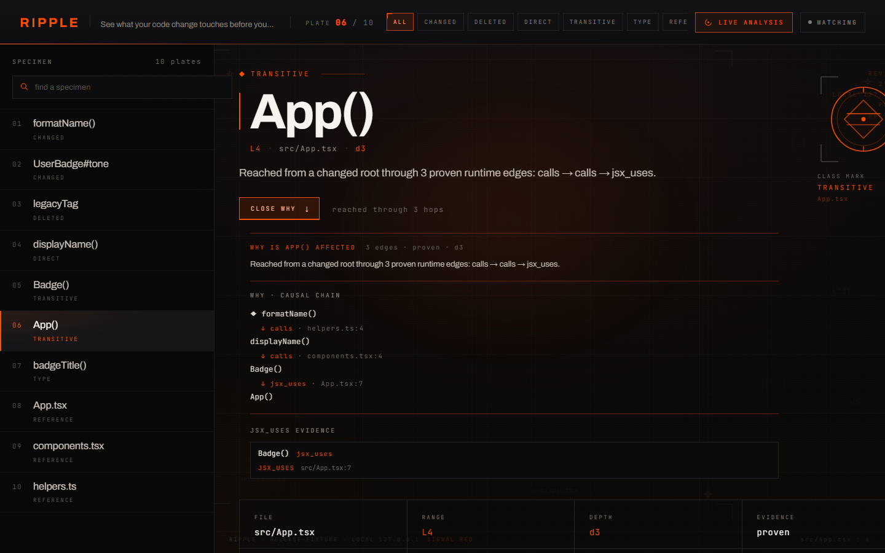
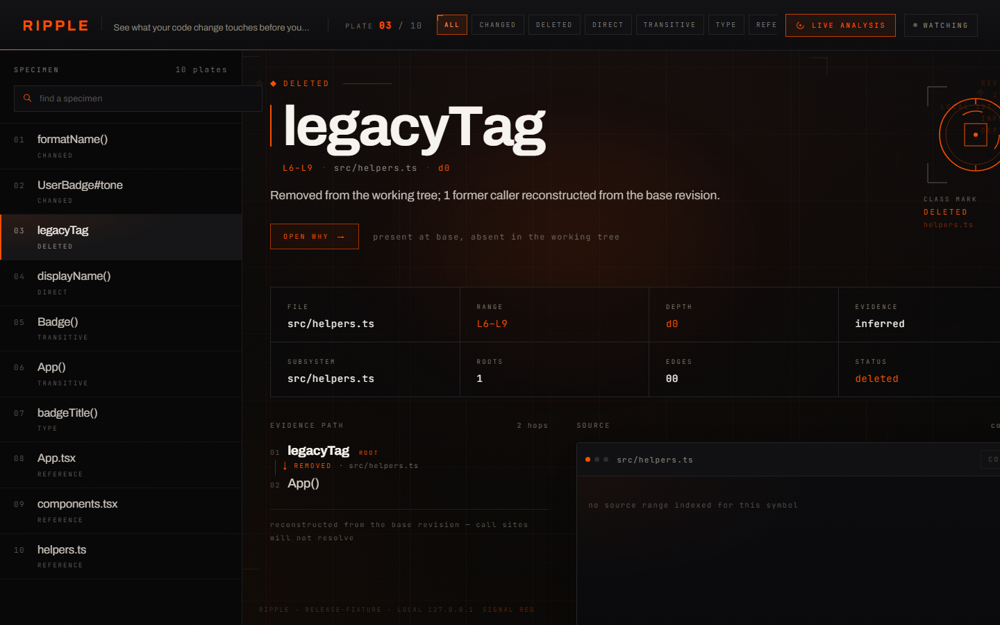

# Ripple

See what your code change touches before you ship it.

Ripple is a deterministic change-impact engine for TypeScript and
JavaScript, with **experimental Python support** on this branch. Point it
at a git diff and it answers: **which symbols could
be affected, why, and which tests cover them** — with a concrete
evidence path for every claim. It does not guess; every reported
relationship is backed by an indexed symbol reference or a parsed
type-position usage.

> Ripple v0.1.0 — the first stable public release of the current
> CLI/explorer surface, distributed via GitHub Releases. Feedback:
> <https://github.com/Aliferous3/ripple-impact/issues>

## Install

**Stable — v0.1.0** (TypeScript/JavaScript):

```sh
npm install -g https://github.com/Aliferous3/ripple-impact/releases/download/v0.1.0/ripple-impact-0.1.0.tgz
```

**Prerelease — v0.2.0-beta.1** (adds experimental Python):

```sh
npm install -g https://github.com/Aliferous3/ripple-impact/releases/download/v0.2.0-beta.1/ripple-impact-0.2.0-beta.1.tgz
```

No npm account needed — this installs the published release artifact
directly. The package identifier is `ripple-impact`; the command is
`ripple`.

## Quick start

```sh
# inside any TypeScript/JavaScript git repository
ripple impact --base main
```

That's it. Ripple indexes the repository with
[scip-typescript](https://www.npmjs.com/package/@sourcegraph/scip-typescript),
classifies call sites and type positions with the TypeScript compiler
API, builds a local dependency graph, and reports the blast radius of
your change:

```text
  Comparing main → working tree

  Changed           2
  Runtime affected  2
  Type affected     2
  Relevant tests    1
  Warnings          0
```

Every affected symbol comes with a **WHY** — the evidence chain of
calls/type dependencies that connects your change to it.

First analysis on a large project can take a while (a full
scip-typescript index — roughly 20s for ~500 source files). Results are
cached content-addressably under `.ripple/`, so repeat runs are fast.
Add `.ripple/` to your `.gitignore`.

Want a sandbox first? `ripple demo` materializes a tiny git repo
exercising every category (runtime impact, type impact, tests, evidence
paths) and prints the commands to run against it.

## Visual explorer

```sh
ripple explore --base main
```

Opens a local web UI — the specimen explorer. Each affected symbol is a
plate: its classification (CHANGED / RUNTIME / TYPE / TEST / DELETED /
REFERENCE), a searchable rail of every plate, and an expandable
**OPEN WHY** panel showing the causal chain of calls/type dependencies
from your change to that symbol, with source and diff context.

The explorer watches the working tree by default — save a file and it
re-analyzes and updates live over server-sent events. If live analysis
fails, an `ANALYSIS INTERRUPTED` strip appears while the last valid
result stays on screen; recovery happens without a reload. Use
`--no-watch` to disable, `--no-open` to skip the browser launch, and
`--port n` to pick a port.

| WHY causal chain (calls → jsx_uses) | Deleted-symbol tombstone |
| --- | --- |
|  |  |

## What Ripple reports

| Category          | Meaning                                                          |
| ----------------- | ---------------------------------------------------------------- |
| Changed           | Symbols whose own source the diff modified/added/removed         |
| Runtime affected  | Reachable through `calls`/`implements` edges from changed code    |
| Type affected     | Reachable through `type_depends` edges (type positions only)      |
| Relevant tests    | Test files that call into the affected set                        |
| Referencing       | Symbols referencing changed symbols (non-propagating context)     |
| Deleted           | Historical callers of symbols the diff removed                    |
| Warnings          | Unmapped diff regions, unindexed files, conservative boundaries   |

**Runtime vs type impact is deliberately separate.** A function whose
*body* calls your changed code is runtime-affected; a function that
merely *annotates a parameter* with your changed type is type-affected.
Type-only changes (e.g. adding a field to an interface) produce type
impact without claiming runtime callers are affected.

## Commands

```text
ripple impact   [symbol] [--root dir] [--base ref] [--in file] [--json]
ripple explore  [symbol] [--root dir] [--base ref] [--port n]
                [--no-open] [--no-watch]
ripple changed  [--root dir] [--base ref] [--json]
ripple analyze  [--root dir]
ripple inspect  <symbol|file::symbol> [--root dir]
ripple cache    status|clear [--root dir]
ripple demo
```

`--json` emits the full `AnalysisResult` (schema version 2) on stdout —
piping-safe, since progress and human output go to stderr. `--quiet`
suppresses human output. `--verbose` adds index/cache details.

Default comparison is `HEAD` vs the working tree; `--base <ref>`
compares the merge-base of `<ref>` with the working tree. Exit codes:
`0` success, `1` analysis failed, `2` invalid usage — finding a large
blast radius is **not** an error.

## How it works

```text
git diff → changed ranges → changed symbols
        → reverse BFS over the Ripple graph
        → runtime impact / type impact / tests / evidence paths
```

The graph is built from a SCIP index (canonical symbol identity:
definitions, references, re-exports, implementations) enriched by a
deterministic AST pass that classifies call sites and type positions
(annotations, generics, heritage clauses, `typeof`, `import type`).
SCIP alone can't distinguish a call from a type mention — that
distinction is what makes the runtime/type split sound.

Requires Node.js ≥ 22, git, and a TypeScript/JavaScript project
(`tsconfig.json` or `jsconfig.json`). Python projects are detected
automatically (`pyproject.toml`, `requirements*.txt`, …) and need
**Python ≥ 3.10** on PATH (`python` → `py -3` → `python3`) plus the
bundled scip-python indexer — no manual tooling install, no build step,
daemon, or account needed.

## Privacy

Ripple runs entirely on your machine. Source code is never uploaded —
indexing is a local scip-typescript subprocess, the explorer binds to
`127.0.0.1`, and the cache lives in `<repo>/.ripple/`. There is no
telemetry, no account, and no network access beyond the initial `npx`
download of the package itself.

## Supported languages and limitations

- **TypeScript** fully; **JavaScript** where scip-typescript can index
  it.
- **Python** experimentally, via scip-python + a stdlib `ast`
  classification pass — same reference-≠-call discipline, dynamic
  constructs (`getattr`, unresolved receivers, metaclasses) are reported
  as misses rather than guessed. Mixed TS+Python repos analyze both
  families with provenance but no cross-language edges yet. Details:
  `docs/PYTHON-EXPERIMENTAL.md`, `docs/MULTI-LANGUAGE-ARCHITECTURE.md`.
  Other languages are not supported.

### Capability matrix

| Feature | TS/JS | Python |
|---|---|---|
| Definitions | yes | experimental |
| References | yes | experimental |
| Calls | yes | experimental |
| Type dependencies | yes | experimental |
| Inheritance | yes | experimental |
| Relevant tests | yes | experimental |
| Deletion / former callers | yes | experimental |
| Live watch | yes | experimental |
| Cross-language propagation | no | no |

### The trust model — a reference is not a call

Python edges follow the same rule as TypeScript: a resolved reference
alone never becomes a runtime call. Ripple emits a `calls` edge only
when **both** agree — scip-python's semantic resolution identifies the
target symbol *and* Python's own `ast` proves the occurrence sits in a
syntactic call position. Type annotations intersect the same way to
produce `type_depends`. Nothing is inferred from names.

### Windows note for Python

`scip-python` 0.6.6 has two upstream Windows defects: it crashes at
load (`new RegExp(path.sep)` is invalid under a `\` separator), and it
emits an empty index when given backslash `--cwd`/`--output` paths.
Ripple contains both inside the spawned child process — a launcher
shim plus forward-slash argument normalization — and Windows is a
qualified target. **The shim is coupled to scip-python 0.6.6**; any
scip-python upgrade requires explicit requalification before release.
- Indexing is not incremental: every content change re-runs
  scip-typescript for the whole project (the per-file AST enrichment and
  unchanged-fingerprint saves are cached). Expect ~15–25s on a ~500-file
  project, ~1–3s on small ones.
- Conservative boundary: a function that merely *calls* a type-affected
  function is not flagged type-affected — it needs its own type-position
  usage. Dynamic calls (`obj[key]()`) and some class-member changes are
  under-reported; Ripple prefers missing a true edge over inventing a
  false one, and reports warnings when it can't map a diff region.
- Windows is the development platform and is CI-tested; Linux is
  CI-tested. macOS is expected to work but is not yet verified.

## Cache

Analysis artifacts live under `<repo>/.ripple/cache/<fingerprint>/`.
The fingerprint hashes every indexable source file plus
`tsconfig*`/`jsconfig*`/`package.json`/lockfiles and the
scip-typescript + graph schema versions — uncommitted edits, config
changes, and dependency changes all invalidate. Base graphs for
committed revisions are keyed by commit SHA and reused forever.
Per-file AST enrichment is additionally cached by content hash under
`.ripple/cache/enrich/`, so a fingerprint miss only re-classifies the
files that actually changed.

## Development

```sh
npm install
npm run ripple -- impact --root <git-repo> --base main   # run from source (tsx)
npm test          # unit/integration tests (vitest)
npm run test:e2e  # explorer browser tests (playwright)
npm run typecheck
npm run build     # compiled CLI + explorer bundle → dist/
npm pack          # produces the distributable tarball
```

Architecture and per-tranche evidence: `docs/TRANCHE-0-FINDINGS.md`
through `docs/TRANCHE-4-FINDINGS.md`.

## License

Apache-2.0 — see `LICENSE`.
